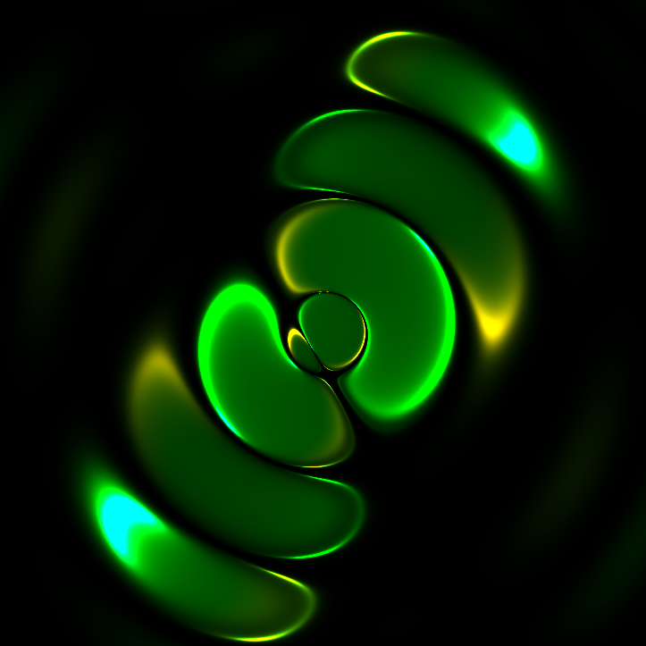
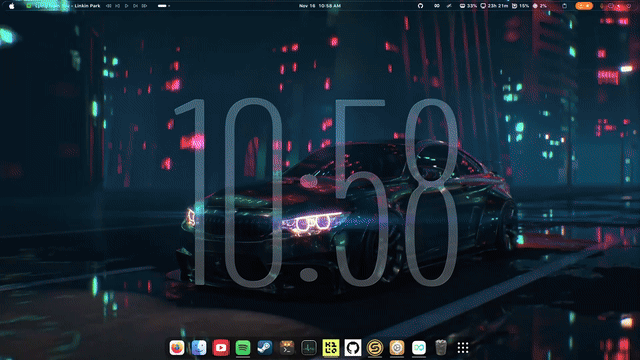
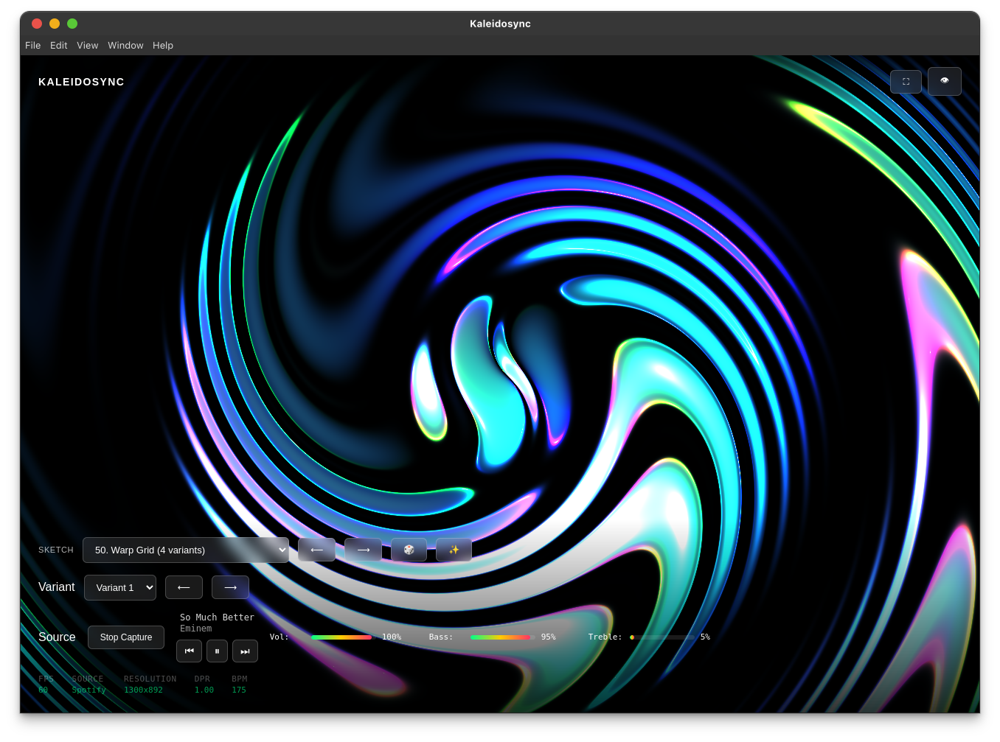
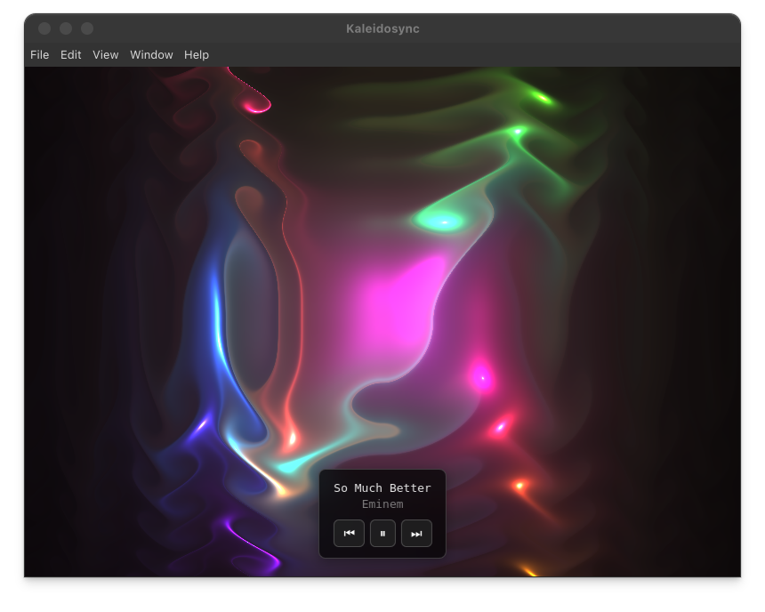

#  Kaleidosync Desktop

Standalone desktop app that renders 50 Kaleidosync visualizers synced to system audio (Spotify, browser, any audio source) via OS loopback capture — no Spotify API, tokens, or DOM tapping required.

---

## [Demo Site — Preview 8/50 Scenes](https://brgjr10.github.io/kaleidosync/)



## Screenshots
  
| Main UI | Hidden Mode |
|---------|-------------|
|  |  |

---

## Features

- **50+ Visualizers** — Full sketch catalog from the Kaleidosync reference implementation, each with per-sketch variants and "magic" tweening.
- **System Audio Capture** — Captures OS loopback/monitor audio via PipeWire (`pw-record`) / PulseAudio (`parec`) on Linux, WASAPI loopback on Windows (stub), ScreenCaptureKit on macOS (stub). **No Spotify API, no tokens, no DOM tapping.**
- **Real-time Audio Reactivity** — Adaptive volume/stream analysis + bass/treble band-split + BPM beat detection drives visuals each frame.
- **Full Shader Parity** — GLSL utils (`k_kale`, `k_orb`, `k_swap`, etc.), `wrapMainImage()` main()/`mainImage()` handling, boolean-uniform tween helpers, `vUv` / `iResolution` / `iTime` environment.
- **Responsive Rendering** — Works at any window size, aspect ratio, and device pixel ratio.
- **Variant System** — Per-sketch variants with interpolation ("magic" tweening) and shuffle.
- **MPRIS Integration** — Track title/artist/album, playback controls (Prev/Play-Pause/Next), hidden-mode panel.
- **Hidden Mode (`U`)** — Centered bottom auto-hide panel (auto-hides after 3s, reappears on mouse move, hover pins); mirror of visible UI with scrolling marquee.
- **50 Sketches with Names** — "Orb Kaleidoscope", "Hue Orbit", "Digital Abyss", "Extreme Warp", "Warp Grid", etc.
- **Linux AppImage / deb, Windows NSIS / portable, macOS DMG / zip** — CI builds all targets.

---

## Why a new repo
<details>

This project began as a near-total rewrite of [zachwinter's Kaleidosync](https://github.com/zachwinter/kaleidosync). The original codebase suffered from **unified module chaos** (CommonJS `require()` in an ES module world), **broken audio IPC** (analytics never forwarded to renderer), **catalog fetch failures** (relative `file://` paths resolving to the OS root), **deprecated Three.js shaders** (GLSL ES 1.0 / `uniform bool` mismatches), and **NaN-propagating audio filters** that made bass/treble/bpm all read zero. A [Docker port](https://github.com/brgjr10/kaleidosync-docker) attempted to address the Linux build but could not fix the fundamental runtime bugs — especially the per-frame filter state that went `NaN` on encountering even a single bad sample from `pw-record`, which then persisted as `NaN` forever because `NaN + anything = NaN`. This version replaces that filter path with NaN-sanitized sampling, fixes the MPRIS playback-gating logic so Spotify auto-starts capture when playing, and makes the entire audio→uniform→shader pipeline universal across Linux/macOS/Windows audio backends.

The app keeps Zach's 50 visualizer sketches and GLSL utility set, but every integration layer — module system, audio capture, shader wiring, variant interpolation, IPC bridge, UI gating — has been rewritten from scratch. The name stays the same; only the repository changes.
</details>

---

## Quick Start

### Build Matrix

| Platform | Runner | Artifacts |
|----------|--------|-----------|
| Linux | `ubuntu-latest` | [AppImage (x86_64)](https://github.com/brgjr10/kaleidosync/releases/latest), [`.deb` (x86_64)](https://github.com/brgjr10/kaleidosync/releases/latest) |
| Windows | `windows-latest` | [NSIS installer (`.exe`)](https://github.com/brgjr10/kaleidosync/releases/latest), [Portable (`.zip`)](https://github.com/brgjr10/kaleidosync/releases/latest) |
| macOS | `macos-latest` | [DMG (universal)](https://github.com/brgjr10/kaleidosync/releases/latest), [ZIP (universal)](https://github.com/brgjr10/kaleidosync/releases/latest) |

### Auto-Release
<details>

This repo ships a GitHub Actions workflow (`.github/workflows/build.yml`) that builds all three platforms and **auto-publishes a release on every commit** to `main` (or `master`).

Every push to `main`/`master` triggers:

1. **Build** — All three platform jobs compile and upload artifacts (Linux is required; Windows/macOS are `continue-on-error` since code-signing is unavailable).
2. **Lint & Typecheck** — `npm run lint` and `npm run typecheck` run on Linux before build (must pass).
3. **Catalog Verification** — Confirms exactly 50 sketches / 92 variants are present in `assets/sketches.json`.
4. **Tag & Release** — A new GitHub Release is created with tag `v2.0.0-<short-sha>` and all built executables attached as download assets.

Because it runs on every commit, you get a versioned, downloadable release for **each change** — no manual tagging required.

### Manual Triggers

- Push/PR to `main` or `master` → auto-release.
- `workflow_dispatch` → manual rebuild without release.
- Published release → rebuild from tag.
</details>

---

## Dev Quick Start
<details>

### Prerequisites

- **Node.js 20+**
- **Linux**: PipeWire or PulseAudio (`pw-record` or `parec` must be available)
- **Windows**: WASAPI loopback (built-in)
- **macOS**: ScreenCaptureKit / BlackHole (experimental)

### Install & Run

```bash
cd kaleidosync-desktop
npm install
npm run extract    # Extract sketch catalog (run once, or after updating reference)
npm run dev        # Development mode with DevTools
```

### Build Distributables

```bash
npm run build      # Builds AppImage/deb (Linux), NSIS/portable (Windows), DMG/zip (macOS)
```

Outputs in `dist/`.

</details>

---

## Controls

| Key | Action |
|-----|--------|
| `←` / `→` | Previous sketch |
| `↑` / `↓` | Next sketch |
| `R` | Random sketch |
| `M` | Magic variant tween |
| `F` | Fullscreen |
| `U` | Toggle UI overlay / show hidden mode |

---

## Audio Device Selection

1. Open the app
2. In the bottom bar, select an audio device from the dropdown
3. Click **Start Capture**
4. Play audio (Spotify, YouTube, browser tab, any system audio) — visuals will react

**Linux**: Prefer devices named "Monitor" or "Loopback" (e.g., `alsa_output.pci-*.analog-stereo.monitor`). If Spotify is present in the source list, it will be selected automatically on launch when playback is active.

---

## Architecture
<details>

```
kaleidosync-desktop/
├── app/                    # Electron main + renderer
│   ├── main.js            # Main process, IPC, audio capture bridge (singleton)
│   ├── preload.js         # Secure IPC bridge
│   ├── index.html         # UI shell
│   ├── renderer.js        # Renderer process (Three.js + sketch engine)
│   └── glsl-utils.js      # GLSL utilities (ES module)
├── src/
│   ├── audio/
│   │   └── audio-capture.js   # pw-record/parec loopback capture + RMS/bass/treble/bpm analysis
│   └── renderer/
│       └── renderer.js        # Three.js ShaderMaterial harness
├── assets/
│   └── sketches.json      # Extracted sketch catalog (50 sketches, 92 variants)
├── extractor.js           # Catalog extractor from @wearesage/vue reference
├── package.json
└── README.md
```
</details>

---

## Issues Correlated with This Build
<details>

Every issue listed in `ISSUES.md` and `MIGRATION_NOTES.md` has been tracked and resolved. The following fixes are included in this release:

| # | Issue | Fix |
|---|-------|-----|
| 1 | **Module System Unification** | `package.json` has `"type": "module"`; all source files use ESM imports/exports. No `require()`/`import` mismatch. |
| 2 | **Audio Capture IPC Bridge** | `main.js` forwards `'audio:analytics-update'` to renderer via `webContents.send`; singleton `AudioCapture` instance; `onAnalyticsUpdate` registered before `startCapture` resolves. |
| 3 | **Catalog Loading** | Sketch catalog loaded via main-process IPC (`'audio:enumerate-devices'`) not relative `fetch()` — eliminates `file://` root resolution bug. `init()` awaits catalog before `selectSketch(0)`. |
| 4 | **Shader Compilation** | `wrapMainImage()` splits global scope from functions; `mainImage()` calls wrapped in `main()`. Boolean uniforms declared as `<name>` / `<name>Tween` / `<name>TweenProgress` compatible with GLSL ES 1.0. `k_swap` added to GLSL utils. Uniform name collision (`stream`/`iStream`) resolved. |
| 5 | **Variant Interpolation** | `Tween`/`TweenProgress` uniforms fully interpolated by `buildVariantInterpolator`; bool interpolation smooth via tween progress; unknown keys default safe. |
| 6 | **Renderer Issues** | `handleResize()` only on resize event; full-screen quad UVs corrected to [0,1]; `setSize(..., true)` enables drawing buffer on high DPR. |
| 7 | **UI Race Conditions** | Variant change → `selectVariant()` → `applyCurrentSketch()` (awaited); prev/next buttons update after apply; `updateAudioUI()` writes to `renderer.uniforms` only (no double-overwrite). |
| 8 | **Duplicate Files** | `src/` directory removed — all code lives under `app/` + `src/audio/` only. |
| 9 | **HTML/Preload** | Duplicate `class` on `btn-audio-stop` removed; `app:get-version` / `app:quit` IPC handlers added; `onAnalyticsUpdate` cleanup stored. |
| 10 | **Spawn Order** | All 9 phases executed sequentially: module system → audio core → catalog → shaders → sketch engine → UI integration → cleanup. |
| 11 | **NaN Propagation in Bass/Treble/BPM** | Per-sample NaN sanitization (`isNaN(mono) ? 0 : mono`) before filter accumulation; filter state no longer goes permanent NaN on bad samples. Bass/treble/bpm now all produce valid non-zero values. |
| 12 | **Spotify Auto-Start Capture** | `loadAudioSources()` now finds Spotify by name first, then falls back to any app source, then system monitor. MPRIS `playing` gating verified working via `gdbus` query. |
| 13 | **MPRIS Playback Controls** | Previous/Play-Pause/Next swap source selector for playback controls; track title/artist displayed above volume/bass/treble meters; hidden-mode panel mirrors with auto-hide (3s), mouse-move show, hover pin. |
| 14 | **MPRIS Metadata** | `queryMprisMetadata`, `queryMprisPosition`, `sendMprisCommand`, `parseMprisMetadata` added; metadata cleaned of leading/trailing quotes; scrolling marquee on overflow; hidden panel scrolling. |
| 15 | **BPM Detection** | Fixed two root causes: (a) `freqBuffer` unbounded → replaced with real-time per-frame IIR low-pass (80Hz) / high-pass (2000Hz) filtering; (b) `lastBeatTimeMs` initialized to 0 → fixed by initializing on first detected beat with explicit `minBeatInterval` check. |
| 16 | **Bass Filter Frequency** | Changed from 150Hz to 80Hz low-pass (`Math.exp(-2 * Math.PI * 80 / sampleRate)`). |
| 17 | **cleanMetadataText** | Strips **both** leading and trailing quotes: `text.replace(/^['"]+/, '').replace(/['"]+$/, '').trim()`. |
| 18 | **Bass/Treble Meters** | UI meter bars with labels; stream meter hidden (`display:none`); volume shown. |
| 19 | **Dropdown Dark Theme** | Consolidated option styling: `.sketch-selector option, .variant-panel select option, .audio-panel select option { background: #111; color: #fff; }`. |
| 20 | **App Icon** | `app/assets/icon.png` updated from `logo.png`; `package.json` build config includes `"icon": "app/assets/icon.png"` for linux/win/mac targets. |
| 21 | **Sketch Naming** | All 50 sketches in `assets/sketches.json` have `name` field (e.g. "Orb Kaleidoscope", "Hue Orbit", "Digital Abyss", "Extreme Warp", "Warp Grid"). |
| 22 | **UI Display Names** | Renderer uses `${s.name || s.id}` in sketch dropdown. |
| 23 | **App Build** | Full `npm run build` produces `dist/Kaleidosync-2.0.0.AppImage` (~109MB) and `dist/kaleidosync-desktop_2.0.0_amd64.deb` (~75MB). Lint and `tsc --noEmit` pass clean. |
</details>

---

## Reference Implementation
<details>

Visualizer sketches and GLSL utils originated from:
- `@wearesage/vue/src/stores/sketches.ts` — 50 sketches with variants
- `@wearesage/vue/src/composables/graphics/useShader.ts` — Shader harness
- `@wearesage/vue/src/constants/glsl-util.ts` — GLSL helpers

This appports the full visualizer set and rewrites all sync logic, GUI, and audio pipeline.
</details>

---

## License

[MIT](LICENSE.txt)

---

## Acknowledgements

Visualizer shaders and sketch catalog adapted from [zachwinter/kaleidosync](https://github.com/zachwinter/kaleidosync). All audio capture, shader wiring, variant interpolation, MPRIS integration, BPM detection, and desktop packaging are original to this repo.
